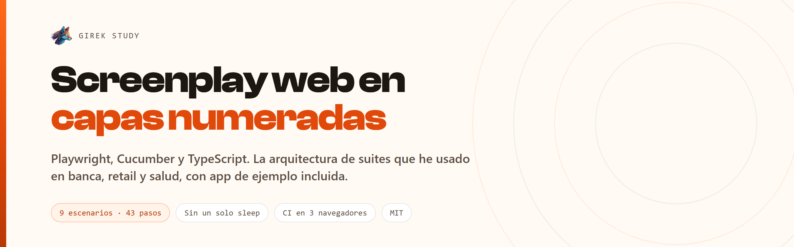

<p>
  
  
  
  
  <a href="https://github.com/Girek-Study/screenplay-web-bdd/actions/workflows/ci.yml"></a>
</p>

Framework de automatización web con **patrón Screenplay en capas numeradas**: Playwright,
Cucumber y TypeScript. Trae su propia app de ejemplo, así que se clona y corre sin
configurar nada ni depender de ningún sitio ajeno.

```bash
git clone https://github.com/Girek-Study/screenplay-web-bdd.git
cd screenplay-web-bdd
npm install
npx playwright install chromium
cp .env.example .env
npm test
```

```
9 scenarios (9 passed)
43 steps (43 passed)
0m08.358s
```

Es la arquitectura que he usado en suites de banca, retail y salud, reescrita sobre una
app propia. El código es el mismo; el dominio, no.

---

## Por qué las carpetas van numeradas

```
Framework/
  0001.Features/      el Gherkin, en español
  0002.Steps/         traducen una frase a una task — y nada más
  0003.Actors/        quién ejecuta
  0004.Interactions/  las acciones mínimas: pulsar, escribir, navegar
  0005.Interfaces/    solo selectores
  0006.Models/        los datos, nunca las credenciales
  0007.Tasks/         el lenguaje de negocio: "IniciarSesion", "AgregarTarea"
  0008.Questions/     las aserciones
  0009.Utils/         ciclo de vida, navegador, evidencia, configuración
  0010.Runners/       el arranque
```

El orden de las carpetas **es el recorrido de una prueba**. Alguien que entra al
proyecto no necesita que le expliquen dónde empezar a leer: el explorador de archivos
ya lo ordena por él, de la frase en Gherkin hasta el proceso que la ejecuta.

Parece cosmético y cambia el onboarding. Un `src/` alfabético pone `actors` antes que
`utils` y `features` entre medias, sin que nada indique qué llama a qué.

## Las reglas que sostienen esto

**Un step no sabe pulsar.** Si un step contiene un selector, la capa se rompió. El step
traduce la frase y delega.

**Una interface solo tiene selectores.** Ni una espera, ni una acción, ni una aserción.
Cuando la interfaz cambia, se toca un archivo.

**Una task garantiza su postcondición.** `IniciarSesion` termina comprobando que la
pantalla de tareas está a la vista. Una task que deja al actor a medio camino hace
fallar la siguiente con un error que no tiene nada que ver con la causa.

**Ningún sleep.** No hay un solo `waitForTimeout` en el framework. Las esperas las hacen
las aserciones de Playwright, que reintentan hasta su timeout.

La app de ejemplo tarda **250 ms a propósito** en agregar una tarea. Está ahí para que la
suite se enfrente a interfaz asíncrona de verdad: si pasa con ese retardo, no depende de
sleeps. Es la prueba de que la regla se cumple.

**Los selectores van por `data-testid`.** La clase cambia con el rediseño y el texto
cambia con el idioma.

**El nombre del actor es un rol.** `new Actor('Ana')` aparece en el informe y en el
mensaje de error. «El usuario» no distingue nada cuando el fallo solo le ocurre al
administrador.

## Qué se ve al correrlo

```gherkin
# language: es
@web @tareas
Característica: Gestión de tareas

  Antecedentes:
    Dado que Ana abre la aplicación
    Y ingresa como "valido"

  @smoke @regresion
  Escenario: Agregar una tarea
    Cuando agrega la tarea "Revisar el informe de regresión"
    Entonces la lista tiene 1 tarea
    Y el contador dice "1 pendiente"
```

Y el step que lo sostiene, entero:

```ts
Given('(que )agrega la tarea {string}', async function (tarea: string) {
  await actorActual().attemptsTo(AgregarTarea.con(tarea));
});
```

## Dos trampas del Gherkin en español

Cuestan una tarde a quien no las conoce, y están comentadas en el código:

1. **Cucumber-JS no distingue `Given` de `When`.** Son alias del mismo registro.
   Declarar la misma frase con los dos la vuelve ambigua y el escenario muere con
   `Multiple step definitions match` sin haber tocado la aplicación.
2. **La palabra clave en español es «Dado», no «Dado que».** El «que» viaja dentro del
   texto del paso. Por eso las definiciones llevan `(que )`: texto opcional de Cucumber
   Expressions, y la misma definición sirve para «Dado que agrega…» y «Cuando agrega…».

## Comandos

| Comando | Qué hace |
|---|---|
| `npm test` | Toda la suite. Levanta y baja la app de ejemplo sola. |
| `npm run test:smoke` | Solo `@smoke`, sin `@wip`. |
| `npm run test:regresion` | Solo `@regresion`. |
| `npm test -- --tags "@web and not @wip"` | Cualquier expresión de etiquetas. |
| `npm run test:visible` | Con el navegador a la vista. |
| `npm run test:firefox` / `:webkit` | Cambia de motor. |
| `npm run informe` | Convierte el JSON de Cucumber en el informe HTML. |
| `npm run unit` | Las unitarias del propio framework. |
| `npm run demo` | Solo la app de ejemplo, en `localhost:4173`. |

El runner acepta las cuatro formas de pasar etiquetas que la gente escribe de verdad,
incluida `CUCUMBER_TAGS` en el `.env`, y resuelve el binario de Cucumber desde su propio
`package.json` en vez de usar `npx` o los `.cmd` de `node_modules/.bin`. Eso es lo que
evita el «funciona en mi máquina pero no en el contenedor».

## Evidencia

Captura de pantalla en **todos** los escenarios. Vídeo y trace **solo en los que fallan**.

Guardar vídeo de todo llena el disco y nadie lo mira; guardarlo solo de lo que falla es
la diferencia entre una evidencia que se revisa y una carpeta de 4 GB que se borra sin
abrir. El trace, en cambio, se arranca siempre y se descarta al pasar: no se puede
activar a posteriori, cuando ya sabes que hacía falta.

```
Reports/
  html/                  informe navegable, con navegador y entorno
  Screenshots/           todas las corridas
  Videos/   Traces/      solo los fallos
  cucumber-report.xml    JUnit, para el CI
```

## Un framework de pruebas con pruebas propias

`npm run unit` cubre las utilidades: el parseo de etiquetas, la carga de configuración,
el escapado de selectores. No los escenarios — esos son el trabajo de la suite.

Suena redundante hasta el día en que una utilidad rompe treinta escenarios a la vez y
hay que averiguar cuál. Una de estas pruebas existe por un fallo real: un
`Config.Loader` que apuntaba a una ruta mal escrita, de modo que `existsSync` devolvía
`false` y la configuración de ventana se ignoraba **en silencio, durante meses**. No
había error que mirar. Es el fallo más sigiloso que puede tener un framework, y por eso
la prueba no comprueba que el archivo se lea sin lanzar: comprueba que el valor leído
sea el del archivo.

## Cuándo no usar esto

Screenplay cuesta ceremonia: cada acción es una clase. Por debajo de unas **50 pruebas**,
Page Objects a secas te dará lo mismo con menos archivos.

Vale la pena cuando hay varios actores con permisos distintos, cuando las mismas tareas
se recombinan en muchos escenarios, o cuando el equipo crece y hace falta que la
estructura imponga el orden en lugar de un documento de convenciones que nadie relee.

## CI

Tres navegadores en paralelo, con `fail-fast: false` a propósito: un motor que falla no
cancela los otros dos, porque «falla solo en WebKit» ya es media respuesta. El informe
sube como artefacto en los tres casos, también cuando la suite se cae.

También hay `docker-compose.yml` con la misma imagen que usa el CI, para reproducir en
local exactamente lo que corre allí.

## Licencia

MIT. Úsalo, cámbialo, llévatelo a tu proyecto.

---

Hecho por [Giancarlo Palomino](https://girek-study.com) — QA Lead / SDET.
Si prefieres Screenplay sin Cucumber, el mismo patrón con el runner de Playwright está en
[playwright-screenplay-ts](https://github.com/Girek-Study/playwright-screenplay-ts), y
usa **esta misma app de ejemplo**: sirve para comparar los dos enfoques sobre el mismo
flujo.
