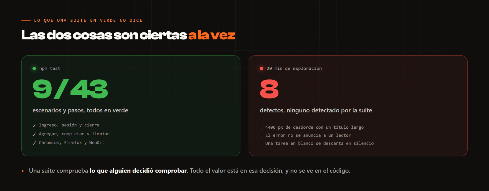

# El trabajo de calidad, antes del código

Un repositorio de automatización enseña **cómo** se automatiza. No enseña **qué** se
decidió probar, ni por qué, ni qué se dejó fuera. Esta carpeta es esa parte.

Está escrita sobre la app de ejemplo que vive en [`demo/`](../demo), la misma contra la que
corre la suite. Se puede seguir entera sin confiar en mi palabra: se clona, se corre y se
comprueba.

| Documento | Qué contiene |
| --- | --- |
| [1. Análisis funcional](01-analisis-funcional.md) | Qué hace la aplicación y qué reglas tiene, incluidas las que no están escritas en ningún sitio |
| [2. Diseño de casos](02-diseno-de-casos.md) | Partición de equivalencia, valores límite, tabla de decisión y transición de estados, aplicadas |
| [3. Matriz de trazabilidad](03-matriz-trazabilidad.md) | De cada regla a su caso, y de cada caso a su escenario automatizado — o al motivo de no automatizarlo |
| [4. Análisis de riesgos](04-analisis-riesgos.md) | Qué se automatiza primero, qué se deja manual y qué no se prueba |
| [5. Defectos encontrados](05-defectos.md) | Ocho, con pasos de reproducción |

---

## El resultado incómodo

La suite de este repositorio pasa **9 escenarios y 43 pasos en verde**. La aplicación que
prueba tiene **ocho defectos**, y uno de ellos rompe la maquetación con 4400 píxeles de
desborde horizontal.

Las dos cosas son ciertas a la vez, y no es una contradicción: **la suite comprueba lo que
alguien decidió comprobar**. Los ocho defectos aparecieron en una sesión de exploración de
veinte minutos, probando lo que ningún escenario probaba.

De ahí sale lo único que de verdad quiero que se lea de esta carpeta:

> Una suite en verde no dice que el producto esté bien. Dice que lo que se decidió
> comprobar, se comprueba. Todo el valor está en esa decisión, y esa decisión no se ve en
> el código.

Por eso estos cinco documentos van antes que los `.feature` en el orden de lectura, aunque
en el repositorio aparezcan después.
